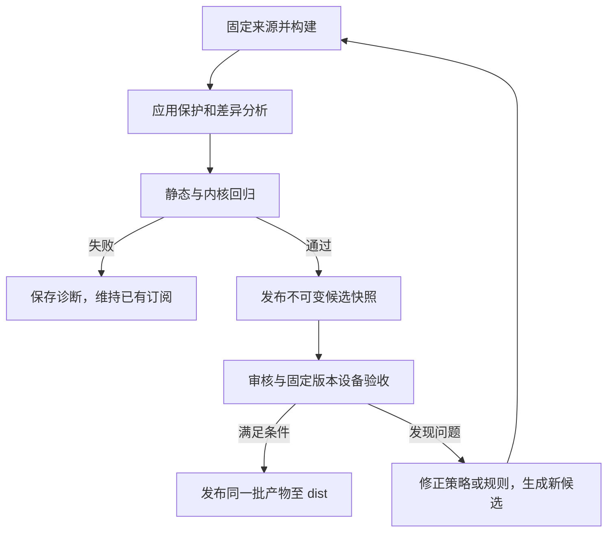

# 发布、版本与回滚设计

状态：目标设计待实施。**当前工作流仍然在构建成功后直接更新 `dist`，本文不会改变这一行为。** 本轮文档更新不暂停定时任务，也不会回退已有规则。现有命令见 [维护指南](maintenance.md)。

## 通道与状态

| 存放位置 | 当前情况 | 目标职责 |
| --- | --- | --- |
| `main` | 已有 | 源码、策略、测试和文档 |
| `candidate` | 尚未建立 | 自动检查后的候选订阅；不是稳定性承诺 |
| `dist` | 已有、自动直发 | 迁移后只发布晋升或回滚的稳定产物，URL 保持不变 |
| Actions 产物与摘要 | 已有 7 天保留的构建产物 | 保存诊断、差异、验证结果；不能作为长期唯一版本存档 |

候选状态为检查失败、待审核、待设备验收、可晋升或已晋升。待审核项被明确批准且必测场景完成后才能可晋升；失败检查不得仅修改状态绕过。

候选分支便于获取最新试验结果；试用和晋升都使用固定候选提交。验证后不能重拉上游或重新构建以替换原文件。

## 候选清单

每个候选须保存版本化 manifest，最少包含源码提交、构建配置与策略哈希、上游固定提交及输入哈希、所有发布文件哈希、稳定基准提交、内核版本与二进制哈希、检查结果和未完成项。

候选版本由内容标识和候选 Git 提交定位；显示时间单独记录，不用于证明内容一致。内容标识排除自身字段和运行时间，避免循环哈希或每轮空变更。稳定发布还需保存绑定候选 ID 的审核与设备验收记录。

规则快照长期保存在候选及发布 Git 历史，manifest 随版本存档；Actions 的短期下载产物只是便利入口。已批准的产物过期时从固定提交恢复并核对哈希，不能重建最新上游冒充旧候选。

## 手动晋升

计划新增手动工作流，输入候选提交和绑定该候选的验收记录位置。步骤为：

1. 获取不可变候选及 manifest，检查所有文件哈希、来源证据、原始许可和测试结果完整。
2. 验证审核项和必测设备场景的记录，记录缺项不能当作通过。
3. 检查源码、保护策略和验证配置没有在验证后发生影响产物的变化；有变化则候选失效，重新构建。纯文档变更不必失效，但要比较实际参与构建的文件指纹。
4. 检查当前稳定提交与候选的稳定基准一致；若另一版本已晋升，旧候选必须重新分析差异与验收影响。
5. 在发布锁内再次读取稳定基准，以普通追加提交方式发布同一批规则字节；生成新的发布记录，不修改已测规则正文。
6. 获取线上文件检查 HTTP 状态、哈希、配套文件和清单一致性；失败则标记异常，按回滚流程处理。

构建任务只读仓库；候选写入与稳定写入分离。PR 不能写发布分支；稳定晋升和回滚共用串行锁，使用非强制推送。

## Mihomo 配套文件的一致性

一次 Git 提交包含两个文件，不代表客户端同时刷新两个 HTTP URL。稳定分支的拦截集与白名单可能因缓存或轮询短暂跨版本。

每版提供引用同一不可变规则提交的 Mihomo 配置示例，供固定版本验收与严格一致性使用；保留现有可变 `dist` 入口供日常刷新，并明确其跨文件更新限制。不能宣称分支更新使客户端自动具备事务一致性。

白名单删除或范围变窄须人工审核；全局稳定订阅的更新也需要考虑短暂混版。首阶段不增加未经验证的压缩格式或依赖远程多层配置来解决这一问题。

## 回滚与紧急修复

回滚选择一个以前已发布、带完整记录的版本，校验并恢复其产物，以新提交写入 `dist`，保留原历史。它不重新构建、不强推，不改上游源文件。保存回滚原因、目标版本和线上核验结果，并暂缓可能重新引入故障的候选。

严重误拦可以先在受影响设备添加窄范围临时放行，再执行项目回滚；是否长期加入保护策略依据复现证据决定。回滚不能清掉设备缓存，维护说明要提示刷新订阅并复测实际功能。

## 从当前流程迁移

1. 保存当前 `dist` 固定提交和文件哈希作为可回退基线；标记其业务保护尚未完整验收。
2. 完成保护策略和两种内核验证，在独立输出目录验证，不修改用户订阅。
3. 新流程先写候选，在隔离远端测试首次构建、基准读取、待审核、无变化、失败与并发情况。
4. 在一次可审查的工作流变更中，将定时直发改为仅候选更新，同时启用手动晋升；不能让两个工作流继续并行写 `dist`。
5. 发布首个完整验收的稳定候选，核对公开地址和回滚演练结果。

首阶段所有稳定变更均人工晋升，暂不设计低风险变更自动发布到稳定版。稳定机制建立后再根据真实维护记录评估是否需要自动化放宽。
